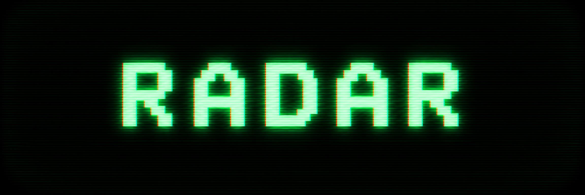
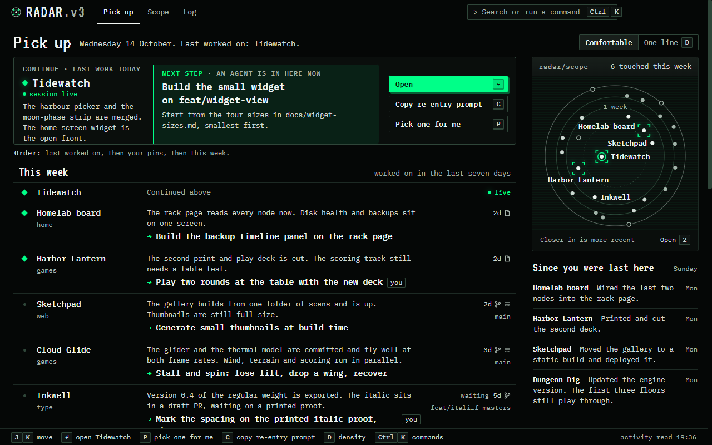
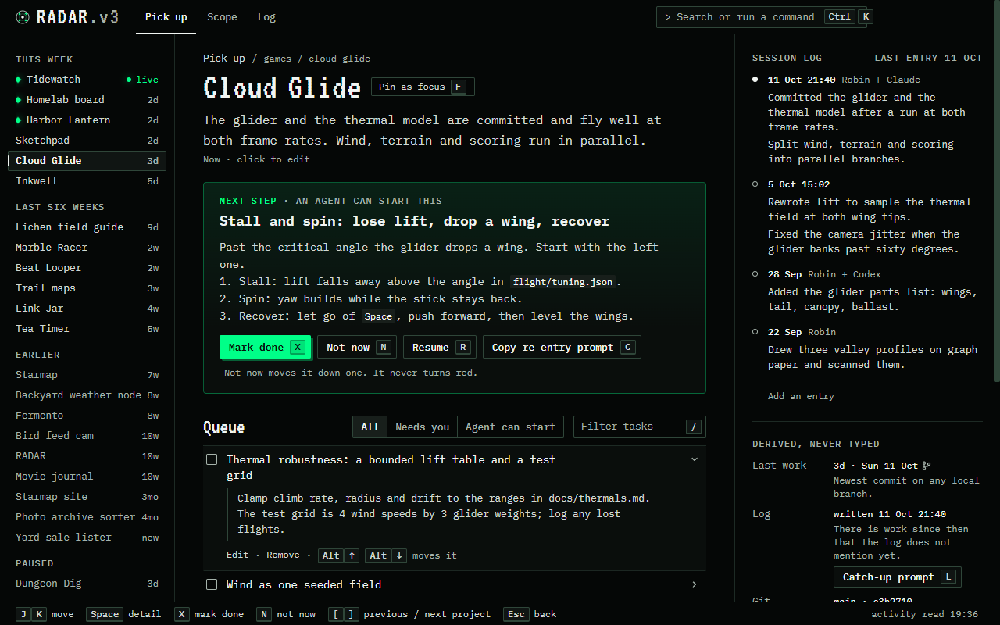
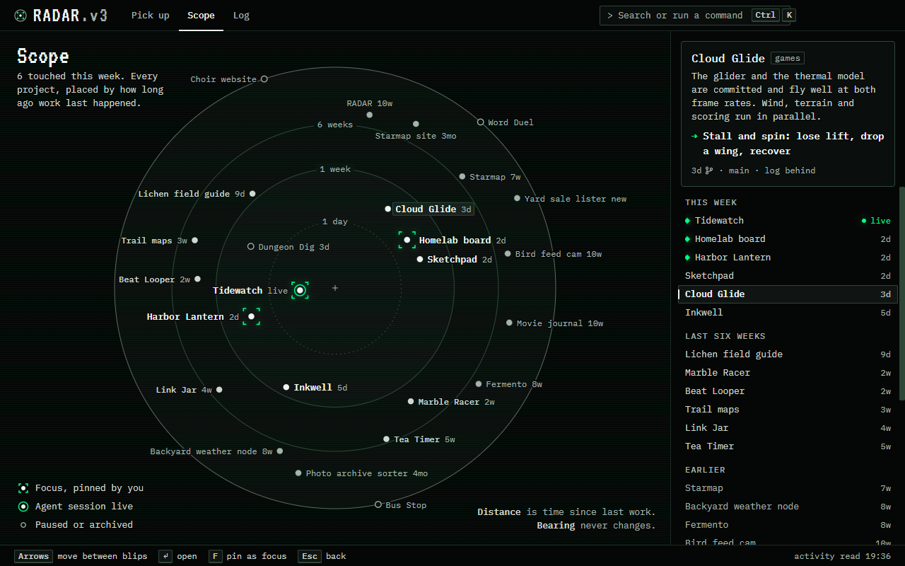
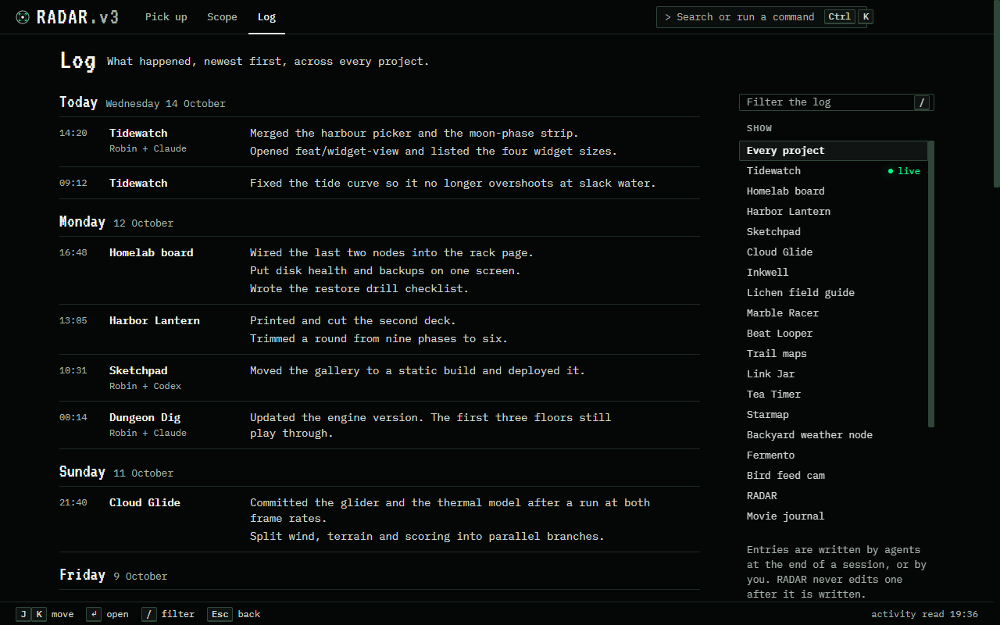
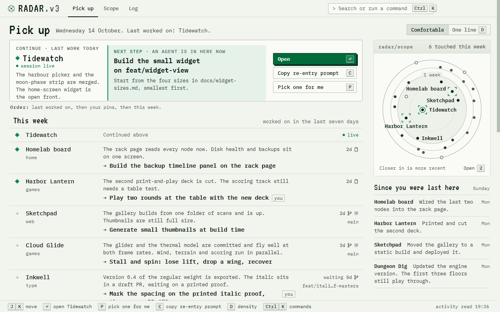

<!-- Hero: CRT wordmark. The image-gen prompt is in docs/assets/README.md. -->
<p align="center">
  
</p>

<p align="center">
  <strong>Pick up where you left off, on every project.</strong><br/>
  A desktop board of everything you are building, kept current by your AI coding agent in a plain <code>BLIP.md</code> per project.
</p>

<p align="center">
  <a href="LICENSE"></a>
  <a href="https://github.com/TerraByte-Dev/RADAR/releases/latest"></a>
  <a href="https://www.npmjs.com/package/radar-blip"></a>
  
  
</p>

<p align="center">
  <a href="#get-started">Get started</a> ·
  <a href="#features">Features</a> ·
  <a href="#what-a-blipmd-is">BLIP.md</a> ·
  <a href="#the-agent-loop">Agent loop</a> ·
  <a href="#the-cli">CLI</a> ·
  <a href="#privacy">Privacy</a> ·
  <a href="#upgrading-from-radar-2">Upgrading from 2.x</a> ·
  <a href="#build-from-source">Build from source</a>
</p>

<p align="center">
  <sub>brought to you by</sub><br/>
  <a href="https://github.com/TerraByte-Dev"></a>
</p>

---

You start a lot of things. RADAR is for coming back to them. Every project you track keeps a
short `BLIP.md` in its folder: one line saying where it stands, a queue whose first open task is
the next step, and a log of what happened. Your coding agent writes it as you work, through the
`/blip` skill and three Claude Code hooks. RADAR reads every one and shows you **what you last
worked on, what it was waiting on, and the one next step**, so re-entering a project costs
seconds instead of an afternoon of rereading.

Nothing is ever overdue. Projects are ordered by when work last happened, read from git and file
times, and a due date is only a date. Everything is local: Markdown files in your folders, no
account, no server.

<p align="center">
  
  <br/><sub><b>Pick up</b> — Continue on top, then every project by when it was last worked on. The data in every screenshot is invented (<code>scripts/demo-data.mjs</code>).</sub>
</p>

## Get started

1. **[Download the latest release](https://github.com/TerraByte-Dev/RADAR/releases/latest)**
   (`RADAR-Setup-<version>.exe`) and run it. If SmartScreen warns about an unrecognised app,
   choose *More info* → *Run anyway*.
2. **Connect to Claude Code.** The first-run screen shows what it will write (three hooks in
   `settings.json`, the `/blip` skill, `radar-blip` on your user PATH) as a diff. Nothing is
   written until you confirm, and you can skip it.
3. **Pick a folder.** RADAR finds every `BLIP.md` under it and asks which to put on the board;
   *Start tracking a folder* writes a fresh one.
4. **Work as usual.** When a session ends with work the log does not mention, the Stop hook asks
   the agent to run `/blip`. The board updates on its own.

> **What you need.** Windows 10 or 11 for the installer. The app bundles its own copy of the CLI
> and a runtime for it, so Node is not required. git is optional: without it, recency comes from
> file times. The agent loop needs [Claude Code](https://docs.anthropic.com/en/docs/claude-code),
> or Codex with the `/blip` prompt run by hand. On macOS and Linux, [build from source](#build-from-source).

The engine and CLI alone: `npm i -g radar-blip` (Node 22.12 or later), then `radar-blip setup`.

## Features

- **Pick up**: *Continue* on the project you last worked on, then every project by when work last happened.
- **Pick one for me** (`P`) deals from your focus pins, then the rest of this week, and says why.
- **Re-entry prompts**: `C` copies one for a fresh agent session; `R` also opens the folder in your editor.
- **The project page**: the Now line, *Mark done*, *Not now*, the queue, the log, and `Ctrl Z` to undo.
- **The Scope** (`2`): distance is time since last work, and a project's bearing never changes.
- **The Log** (`3`): every entry from every project, newest first.
- **Derived, never typed**: last work, branch and "log behind" come from git and file times.
- **Keyboard first**: `Ctrl K` for anything, `?` for every key, `T` for light or dark.

<table>
  <tr>
    <td width="50%" valign="top">
      <br/>
      <sub><b>A project page</b>: Now line, next step, queue, and the session log.</sub>
    </td>
    <td width="50%" valign="top">
      <br/>
      <sub><b>The Scope</b>: paused projects are hollow where their last work puts them; archived ones sit hollow on the rim.</sub>
    </td>
  </tr>
  <tr>
    <td width="50%" valign="top">
      <br/>
      <sub><b>The Log</b>: every project's entries, newest first.</sub>
    </td>
    <td width="50%" valign="top">
      <br/>
      <sub><b>Light</b>: the same board after <code>T</code>.</sub>
    </td>
  </tr>
</table>

## What a BLIP.md is

A Markdown file in the project's root folder, readable in any editor and diffable in git:

```markdown
---
blip: 3
name: Lantern Notes
now: Sync is merged but switched off until the conflict screen is designed.
status: blocked
due: 2026-11-18
tags: [product, mobile]
---

# Tasks

- [ ] Design the conflict screen so sync can be switched on
  Two sketches are in design/conflicts.md.
- [ ] Write the release notes for 4.2

## Done

- [x] Merge the sync engine (done 2026-10-10)

# Session log

## 2026-10-11 16:48 — Robin + Claude
- Merged the sync engine behind the sync_v2 flag
```

The **name, due date, focus pin, tags, links, and pausing or archiving** are yours; agents write
the Now line, the tasks, the log, and the statuses `active` and `blocked`. Every write goes
through the engine, under a lock and atomically, and every byte it does not manage is copied as
it was. The full format is in **[docs/BLIP-SCHEMA.md](docs/BLIP-SCHEMA.md)**.

## The agent loop

`radar-blip setup` (or *Connect to Claude Code* in the app) shows a diff and asks before it
writes. It installs the **`/blip` skill**, which has the agent run `radar-blip brief`, write one
JSON payload and run `radar-blip sync`, and **three Claude Code hooks**:

- **SessionStart** tells the agent the project's Now line and next task, and mentions commits
  nobody has logged yet.
- **Stop** asks the agent to sync when the session made a commit, or edited three files, that the
  project's log does not cover: one project at a time, each at most once every 20 minutes.
- **SessionEnd** closes the marker the app uses to show *session live*.

With Codex installed, setup also writes the `/blip` prompt, which you run at the end of a
session. A hook never blocks a session: on any problem it prints nothing and exits 0.
`radar-blip setup --remove` takes it all out again.

## The CLI

`radar-blip` is the engine behind the app, published on npm and bundled inside the app. Agents
use `brief` and `sync`; from any terminal you have `init`, `show`, `add`, `done`, `set`,
`status`, `track`, `lint`, `migrate`, `setup` and `doctor`, and `radar-blip <command> --help`
explains each. Every command, option and exit code, the sync payload and library use are in
[packages/blip-core/README.md](packages/blip-core/README.md).

## Privacy

- **Reads** the `BLIP.md` of each tracked project, git metadata and file times in those folders,
  and, in the Stop hook, the transcript of the session that is stopping.
- **Writes** `BLIP.md` only through the engine, its own data folder, and, after you confirm
  setup, Claude Code's `settings.json` (with a backup), the skill files and your user PATH.
- **Never writes** your source files, your git repositories or your agent transcripts, and never
  runs anything a `BLIP.md` contains.
- **Network:** only the app's update check against GitHub Releases. No account, no telemetry.

Every file it touches and every git command it runs: [docs/PRIVACY.md](docs/PRIVACY.md).

## Upgrading from RADAR 2

RADAR 3 shows version 2 files read-only and converts nothing until you run `radar-blip migrate`
on one. The steps are in the [CHANGELOG](CHANGELOG.md#upgrading-from-2x).

## Architecture

An npm workspaces monorepo: `packages/blip-core/` is the **`radar-blip`** engine and CLI,
`skills/` the `/blip` skill and Codex prompt, `src/` the Electron app (main, preload, React
renderer), and `e2e/` Playwright against the built app on the invented data set. The renderer
never touches disk: every change goes renderer → `window.radar` → main → engine → `BLIP.md`.
Design rules: [docs/DESIGN.md](docs/DESIGN.md). Releases: [docs/RELEASING.md](docs/RELEASING.md).

## Build from source

```bash
npm install
npm run dev          # builds the engine, then the app with hot reload
npm run typecheck    # engine build + main, renderer and e2e projects
npm test             # app and engine unit tests (vitest)
npm run e2e          # builds, then Playwright against the built app
npm run demo         # builds, then opens the app on the invented data set
npm run package      # electron-builder: an installer for the OS you build on, in dist/
npm run blip -- <args>   # the radar-blip CLI from source
```

Editing `src/main/**` or `src/preload/**` needs a restart of `npm run dev`; renderer changes
reload on their own. In PowerShell, quote the separator: `npm run blip "--" status`.

## License

MIT — see [LICENSE](LICENSE). The bundled IBM Plex Mono and VT323 fonts are under the SIL Open
Font License 1.1.

<p align="center">
  <a href="https://github.com/TerraByte-Dev"></a><br/>
  <sub>An open-source project by <strong>TerraByte Solutions LLC</strong></sub>
</p>
